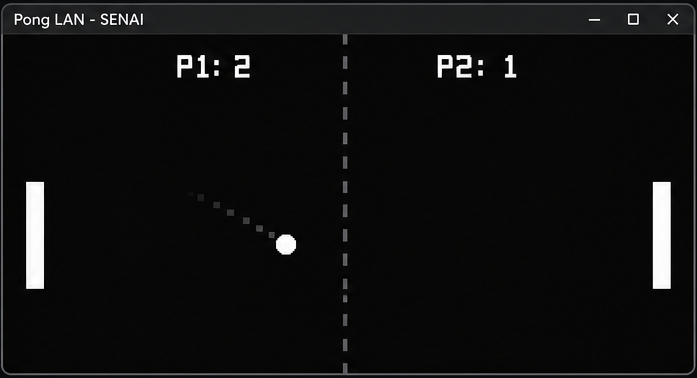

# Pong LAN 🎮

A classic **Pong game made in C with raylib**, developed as part of a networking demonstration for SENAI.



*Concept illustration.*

## Features

- Two-player gameplay on the same keyboard
- Two-player LAN gameplay on Windows x64 using Winsock2
- A 1280 × 720 playfield with three bounce zones on each paddle. The top and bottom send the ball diagonally, and the center sends it straight.
- Ball speed increases by 5% with each paddle hit, up to 14 pixels per frame.
- The first player to score five points wins.

## Controls

| Player | Up | Down |
| --- | --- | --- |
| Player 1 | `W` | `S` |
| Player 2 | `↑` | `↓` |

Press `R` after a match to restart. In LAN mode, player 1 hosts and restarts the match.

## Download and run on Windows x64

Download the Windows x64 ZIP from Releases and extract it on both PCs. Use the
same release on both PCs so they both use LAN protocol version 2. [Releases](https://github.com/rafcrist/pong-lan/releases)

Keep `pong.exe`, `Criar partida.bat`, and `Entrar na partida.bat` together in the
extracted folder. Open `pong.exe` to play on one keyboard.

## Play over LAN

1. Connect both PCs to the same router or network switch.
2. On player 1's PC, run `ipconfig` and find the IPv4 address of the connected
   adapter. Open `Criar partida.bat` to host the match.
3. On player 2's PC, open `Entrar na partida.bat` and enter the host's IPv4 address.

If Windows Firewall prompts the host, allow the game on the private network.
The host listens on UDP port `5000`.

If the network has no DHCP server, assign the connected adapters different
IPv4 addresses in the same subnet. For example, set `192.168.1.10` on the host
and `192.168.1.11` on the guest, both with subnet mask `255.255.255.0`.

### Run from PowerShell

Run the appropriate command on each PC from the folder containing `pong.exe`.

```powershell
# Player 1 (host)
.\pong.exe host

# Player 2 (guest). Replace the example with the host's IPv4 address.
.\pong.exe join 192.168.1.10
```

To test LAN play on one PC, use two terminals and join `127.0.0.1`.

## Build from source (Windows x64)

Open **MSYS2 UCRT64** in the project folder. Install **GCC** and **raylib**, then
build `pong.exe` in the repository root alongside the two `.bat` launchers.

```bash
pacman -S --needed mingw-w64-ucrt-x86_64-gcc mingw-w64-ucrt-x86_64-raylib
gcc main.c net.c -o pong.exe -lraylib -lopengl32 -lgdi32 -lwinmm -lws2_32
```

## Next steps

- [x] Victory screen and restart option
- [x] Multiplayer over a local network (LAN) using Winsock2
- [ ] Connect two Windows PCs through a network switch

**Status:** Work in progress.
