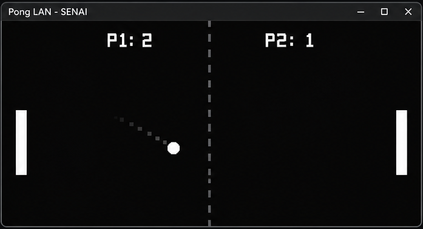

# Pong LAN 🎮

A classic **Pong game made in C with raylib**, developed as part of a networking demonstration for SENAI.



*Concept illustration — not an actual gameplay screenshot.*

## Features

- Two-player gameplay on the same keyboard
- Ball movement and paddle collisions
- Score tracking
- Simple retro-style interface

## Controls

| Player | Up | Down |
| --- | --- | --- |
| Player 1 | `W` | `S` |
| Player 2 | `↑` | `↓` |

## Build and run (Windows)

With **GCC** and **raylib** installed, open **MSYS2 UCRT64** in the project folder and run:

```bash
gcc main.c -o pong.exe -lraylib -lopengl32 -lgdi32 -lwinmm
./pong.exe
```

## Next steps

- [ ] Victory screen and restart option
- [ ] Multiplayer over a local network (LAN) using Winsock2
- [ ] Connect two Windows PCs through a network switch

**Status:** Work in progress.
